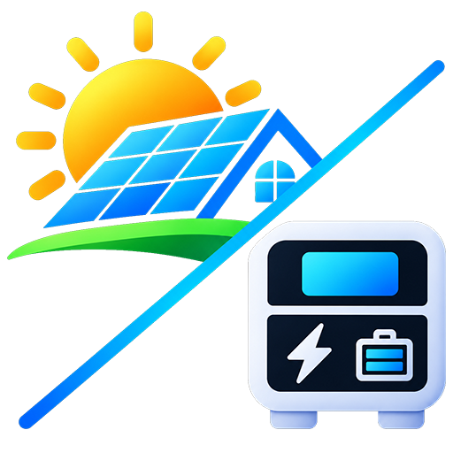

<p align="center">
  
</p>

# HaiPower Cloud - Sandisolar / Aohai Solar Inverter Integration for Home Assistant

[](https://github.com/hacs/default)
[](https://www.home-assistant.io/)
[](https://opensource.org/licenses/MIT)

A comprehensive Home Assistant custom integration for **Sandisolar** and compatible **Aohai HiPower / HaiPower** solar hybrid inverters connected to the `eu.aohaidigitalpower.com` cloud platform.

---

> 📖 **Full Entity Reference & Compatibility Matrix**  
> For an in-depth explanation of every entity, calculation, setting threshold, and model-by-model compatibility breakdown, see the:  
> 👉 **[Detailed Entity Encyclopedia & Inverter Compatibility Matrix](docs/ENTITIES.md)**

---

> ⚠️ **Disclaimer**  
> This is an **unofficial, community-developed integration**. It is not affiliated with, sponsored by, or supported by Sandisolar, Aohai Digital Power, or the HaiPower cloud platform. All product names and trademarks belong to their respective owners.

---

## ☀️ Supported Inverter Families & Grouping

Based on an engineering analysis of 18 technical manuals, the HaiPower Cloud platform supports several inverter architectures, which are organized into **6 functional groups**:

1. **Group 1: `AO / GSA-PRO` Series (Residential 1-Phase 48V LV - Smart Meter, Smart Load & Gen)** *(Primary verified model)*
   * **Covered Inverter Models:**
     * `AO-3~6KSL-G1`: AO-3KSL-G1, AO-4KSL-G1, AO-5KSL-G1, AO-6KSL-G1
     * `AO-3~4KSL-G2` & `AO-5~6KSL-G2`: AO-3KSL-G2, AO-4KSL-G2, AO-5KSL-G2, AO-6KSL-G2
     * `AO-3~6KSL-G3`: AO-3KSL-G3, AO-4KSL-G3, AO-5KSL-G3, **AO-6KSL-G3**
     * `GSA-5~6.2K1P-BL` & `GSA-5~6.2K1P-BL-PRO`: GSA-5K1P-BL, GSA-6.2K1P-BL, GSA-5K1P-BL-PRO, GSA-6.2K1P-BL-PRO
     * `SD-PRO-EU Series`: SD-PRO-EU 6.5K (Sandisolar OEM)
     * `SD-HYM Series`: SD-HYM-4862HWP (IP65 Outdoor Hybrid)
   * **Phase & Battery:** Single-phase 230V AC with 48V Low-Voltage battery (40V–60V DC).
   * **Solar Input:** 1 high-current MPPT (up to 40A DC, 90–450V DC range, max Voc 500V DC).
   * **Smart Meter vs CT:** Zero-export anti-backflow is handled via an **RS485 Smart Meter** (RJ45 pins 7 & 8; register 88 `ctMode`: `0 = Smart Meter`, `1 = CT`). **Notice:** The physical `AO-6KSL-G3` inverter does not have a physical CT clamp terminal on its chassis. Physical CT clamp buttons and CT turns ratio settings are automatically excluded in this profile.
   * **Outputs & Controls:** Dual AC outputs (Main UPS output + Smart Load second output with separate disconnect voltage/SOC thresholds), generator dry-contact auto-start, parallel up to 6 units.

2. **Group 2: `HSC / AH 1P` Series (Residential 1-Phase 48V LV - Dual MPPT, CT Clamp & Meter, EPS)**
   * **Covered Inverter Models:**
     * `HSC-3~8K1P-BL`: HSC-3K1P-BL, HSC-3.6K1P-BL, HSC-4K1P-BL, HSC-5K1P-BL, HSC-6K1P-BL, HSC-8K1P-BL
     * `AH-3~6KSL-G2`: AH-3KSL-G2, AH-3.6KSL-G2, AH-4KSL-G2, AH-4.6KSL-G2, AH-5KSL-G2, AH-6KSL-G2
     * `FSA-3~4K1P-BL`: FSA-3K1P-BL, FSA-4K1P-BL
   * **Phase & Battery:** Single-phase 230V AC, 48V Low-Voltage battery.
   * **Solar Input:** Dual independent MPPT trackers (ideal for East-West roof configurations).
   * **Features:** Physical external CT clamp and RS485 meter support, hardware CT calibration (`reg 96=1`) and detection (`reg 96=2`), <10ms UPS switchover, peak shaving, Time-of-Use (TOU) tariffs, microinverter AC coupling on GEN port.

3. **Group 3: `FSC / HSA 1P` Series (High-Power Residential 1-Phase 48V LV - 8kW to 12kW)**
   * **Covered Inverter Models:**
     * `FSC-8~12K1P-BL` & `FSC-8~12K1P-BL-G3`: FSC-8K1P-BL, FSC-10K1P-BL, FSC-12K1P-BL, FSC-8K1P-BL-G3, FSC-10K1P-BL-G3, FSC-12K1P-BL-G3
     * `HSA-8~12K1P-BL`: HSA-8K1P-BL, HSA-10K1P-BL, HSA-12K1P-BL
   * **Phase & Battery:** Single-phase 230V AC, 48V Low-Voltage battery with high battery current capability (up to 220A).
   * **Features:** 3 to 4 MPPT strings, physical CT clamp & RS485 meter support, CT calibration / detection buttons, parallel operation up to 16 units, heavy generator auto-start.

4. **Group 4: `HUA 3P LV` Series (Commercial/Residential 3-Phase 400V - 48V Low-Voltage Battery)**
   * **Covered Inverter Models:**
     * `HUA-8~15K3P-BL`: HUA-8K3P-BL, HUA-10K3P-BL, HUA-12K3P-BL, HUA-15K3P-BL
   * **Phase & Battery:** Three-phase 400V AC (3L + N + PE), 48V Low-Voltage battery (40V–60V DC).
   * **Features:** **100% unbalanced 3-phase output** (each phase can deliver up to 50% of rated capacity independently), dual MPPTs, 3-phase Smart Meter (Acrel/Chint) or CT clamps, dual EPS backup circuits.

5. **Group 5: `HTA / AH-TH 3P HV` Series (Commercial 3-Phase 400V - High-Voltage 150V–800V Battery)**
   * **Covered Inverter Models:**
     * `HTA-15~30K3P-BH`: HTA-15K3P-BH, HTA-20K3P-BH, HTA-25K3P-BH, HTA-30K3P-BH
     * `AH-4~10KTH-G1`: AH-4KTH-G1, AH-5KTH-G1, AH-6KTH-G1, AH-8KTH-G1, AH-10KTH-G1
     * `AHW-6~10KTHD-G1`: AHW-6KTHD-G1, AHW-8KTHD-G1, AHW-10KTHD-G1
   * **Phase & Battery:** Three-phase 400V AC (3L + N + PE), High-Voltage Battery System (150V–800V DC).
   * **Solar Input:** 2 to 4 MPPT trackers (up to 1000V DC Voc, up to 45kW PV input).
   * **Features:** Commercial 3-phase meter, CAN bus BMS communication. (48V low-voltage lead-acid thresholds are automatically excluded in this profile).

6. **Group 6: `FSF Compact` Series (1-Phase 230V - 12V/24V Compact Balcony / RV Storage)**
   * **Covered Inverter Models:**
     * `FSF-1.5~2K1P-BL`: FSF-1.5K1P-BL, FSF-2K1P-BL
   * **Phase & Battery:** Single-phase 230V AC, 12V or 24V Low-Voltage battery.
   * **Features:** Designed for balcony solar, off-grid cabins, and mobile RV applications. Single MPPT (30–400V), single AC output. (Generator and Smart Load entities excluded).

---

## ⚡ Key Capabilities

* **100% Cloud-Native:** Works via Wi-Fi logger directly through `eu.aohaidigitalpower.com`. No Modbus RS485 converter or custom hardware required.
* **Automatic Captcha Resolution:** Authentication verification tokens are decoded automatically in the background—no manual captcha input.
* **Model Profile & Entity Exposure Modes:**
  * **Auto-Detect Model (Recommended):** Inspects the inverter hardware type string reported by the cloud (e.g. `AO-6KSL-G3`, `SD-PRO-EU 6.5K`, `HSC-6K1P-BL`) and automatically selects the optimal profile.
  * **Manual Group Selection:** Manually pick any of the 6 functional groups.
  * **Full Mode:** Exposes all 87 sensors, 15 switches, 25 numbers, 4 selects, and 3 buttons without any model-based filtering.
  * **Basic Mode:** Lightweight profile exposing only essential Home Assistant Energy Dashboard sensors, electrical measurements, status/fault alarms, and the `Inverter Operation` switch.
* **CT Calibration & Detection Buttons:** Directly trigger hardware CT calibration (`register 96=1`) and polarity detection (`register 96=2`) from Home Assistant on inverters equipped with CT clamp inputs.
* **Predictive Battery Analytics:** Real-time calculation of Battery Charge ETA, SOC speed (%/h), battery power dynamic speed (W/h), and 5-minute moving averages (AVG).

---

## 🔐 Platform Access Codes & Passwords

* **Web Portal & App Advanced Settings Password:** Calculated daily as `ah` + `YYYYMMDD` (e.g. `ah20261107`).
* **Remote Wake Up Code:** `666666`.
* **Inverter Physical LCD Service PIN:** `618`.

---

## 📦 Installation

### Method 1: Via HACS (Recommended)
1. Open Home Assistant $\rightarrow$ **HACS** $\rightarrow$ **Integrations**.
2. Click the top-right menu and choose **Custom repositories**.
3. Add `https://github.com/usera0519/ha-haipower-cloud` with category **Integration**.
4. Click **Download**, then restart Home Assistant.

### Method 2: Manual Installation
1. Download `ha-haipower-cloud.zip` from the latest release.
2. Unpack into your Home Assistant directory under:
   ```text
   /config/custom_components/haipower_cloud/
   ```
3. Restart Home Assistant.

---

## ⚙️ Configuration & Options

1. In Home Assistant, go to **Settings** $\rightarrow$ **Devices & Services** $\rightarrow$ **Add Integration**.
2. Search for **HaiPower Cloud**.
3. Enter your account email and password for `eu.aohaidigitalpower.com`.
4. In the setup dialog:
   * Select your inverter (DSN).
   * Customize the device name.
   * Choose your **Model Profile / Entity Mode** (`Auto-Detect Model`, specific inverter family, `Full Mode`, or `Basic Mode`).
   * Set your preferred cloud polling interval (10–300s, default: 30s).
5. To change settings later (switch profile or adjust polling interval), click **Configure** on the HaiPower Cloud integration card.

---

## 📄 License

This project is licensed under the MIT License - see the [LICENSE](LICENSE) file for details.
